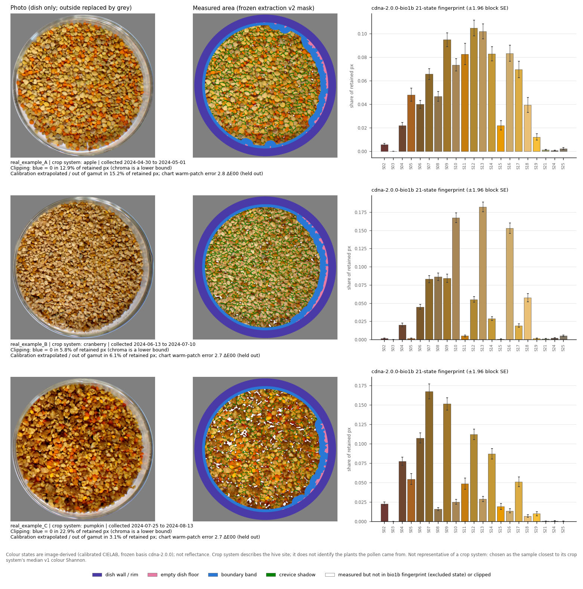
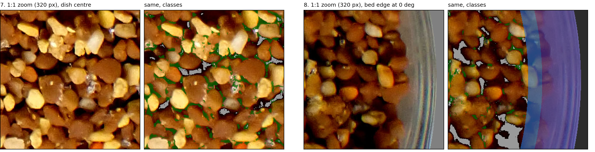
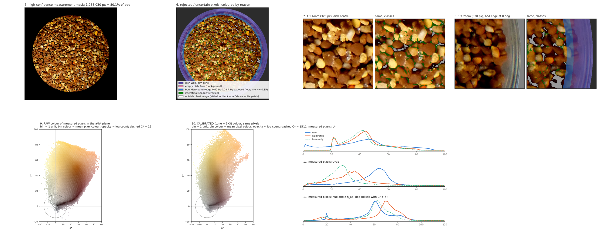
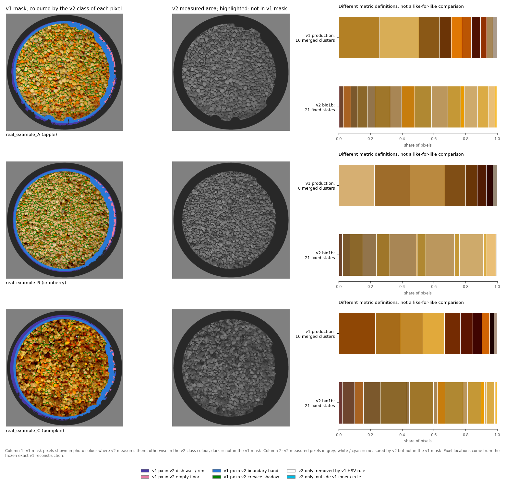
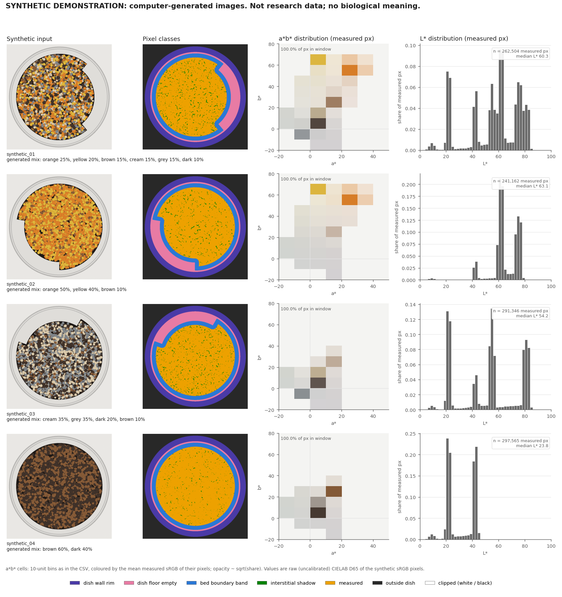

# Measuring pollen colour from photographs

**Author:** Byron Xia ([@eddf-XIA](https://github.com/eddf-XIA))

A public portfolio piece. It shows real-photo examples and QC output from a research image-analysis pipeline,
plus a small runnable demo. The full research pipeline and its data are private.

## Summary

**The problem.** Honey bees bring back pollen loads of many colours. A photo of a pooled pollen sample in a glass
dish could summarise that colour mix cheaply, but a raw photo contains more than pollen. It also shows:
- the glass wall and empty dish floor;
- shadows in the gaps between loads;
- glare;
- pixels clipped to pure black or white.

A naive colour clustering counts those as "colours". The earlier (v1) method did exactly that: its recurring grey
and near-black colours were largely dish glass and crevice shadow.

**What I built.** A second-generation (v2) colour-extraction pipeline that turns each photo into two things:
1. **A measurement mask.** Every pixel gets exactly one **pixel measurement/exclusion class**, each with a recorded
   reason: measured, dish wall/rim, empty dish floor, boundary band, crevice shadow, or clipped. These are
   image-measurement classes. They are not a botanical classification of pollen.
2. **A calibrated colour distribution** of the measured pixels, in CIELAB, with a per-photo QC diagnostic.

**My contribution.** I did the image and colour analysis, developed the method, implemented it, and built its QC,
validation and visualizations. Field sampling, microscopy and DNA work were done by collaborators (see
[My contribution](#my-contribution)).



*Photo → measurement mask → colour distribution, for three real pooled samples. Details in [section 1](#1-real-photo-workflow-photo--measurement-mask--colour-distribution).*



*Per-photo QC: 1:1 zooms showing which pixels are measured (untinted) and which are excluded, and why. Details in
[section 2](#2-qc-illustration-one-repeat-capture-photo-in-detail).*

### Scope at a glance

| | |
|---|---|
| Broader pollen project | Previously processed 8,000+ images |
| v2 extraction shown here | One frozen run on **48 photos**: 44 pooled samples (one primary photo each), plus 4 repeat captures used only for test–retest QC. It was **not** run on the 8,000+ images |
| Colour fingerprints | 44 pooled samples. One colour–DNA association analysis uses 42 of them, after a pre-specified design exclusion. Its results are not reported here |
| The 57 tests | Cover the **runnable synthetic demo** in this repository only, not the research pipeline. The research pipeline's own tests are in the private codebase |
| Real-photo examples | Illustrate measurement and QC. They are **not** independent ground-truth accuracy validation; no pixel-level ground truth exists for real photos |
| Colour values | Image-derived colour, **not reflectance**. Colour states are **not plant taxa** |

## My contribution

**My work, as recorded in the project's records:**
- **Image and colour analysis.** I diagnosed the v1 limitations from its outputs. The v1 grey/taupe colours were
  mostly dish glass and edge pixels, and its near-black colours were crevice shadows. v1 also measured colour
  distance in OpenCV's 8-bit Lab encoding rather than CIE units.
- **Method development.** I designed the v2 rules:
  - geometry-based measurement/exclusion classes with reason codes;
  - a size-based crevice rule, so that pixels are never excluded just for being dark, grey or pale;
  - ColorChecker calibration fitted per capture session;
  - parameters fixed in advance and scaled to the dish radius.
- **Implementation.** The research pipeline in Python: decoding, colorimetry, segmentation, calibration and
  per-pixel outputs. Also this repository: the synthetic scene generator, the demo pipeline, the tests and the
  packaging.
- **QC.** 16-panel diagnostics for every photo, automatic outlier flags, a test–retest comparison of repeat
  captures, and integrity checks. Every stored pixel must reproduce its decoded value and its label map. I
  approved and froze v2 only after my manual review of the QC panels.
- **Validation.**
  - Synthetic scenes with per-pixel ground truth.
  - Held-out ColorChecker calibration error.
  - Agreement between repeat captures.
  - An exact reconstruction of the v1 mask, which reproduced v1's recorded pixel count in all 44 primary photos,
    so that v1 and v2 could be compared on the same photos.
- **Visualization.** The QC panels and every figure in this repository.

**Collaborators' work:** the field sampling (pollen traps at the hives), the pollen microscopy and the DNA
metabarcoding were done by lab collaborators. Their data is not in this repository, and I make no claim to it.

**AI assistance.** I developed the code, analyses and documentation, including this README, with Claude Code
(Anthropic's AI coding assistant). It wrote and revised code, ran analyses and drafted text at my direction. I
made and approved the method decisions, parameter choices and QC sign-off, reviewed the outputs, and chose what to
publish.

## 1. Real-photo workflow: photo → measurement mask → colour distribution


Each row is one pooled sample, from three crop systems (apple, cranberry, pumpkin). The photos are redacted: no
sample IDs, site names, filenames, labels or file metadata. They are shown with the lab's permission.

1. **Photo.** The dish region of the original JPEG. Everything outside the dish is shown as grey.
2. **Measurement mask.** The measured pixels are shown in photo colour. The excluded classes are:
   - **purple**: dish wall/rim;
   - **pink**: empty dish floor;
   - **blue**: boundary band of mixed and glare-affected pixels;
   - **green**: narrow crevice shadows;
   - **white**: clipped pixels, or pixels in colour states excluded from the fingerprint.
3. **Colour distribution.** The measured pixels are calibrated to the in-frame ColorChecker and assigned to one
   frozen 21-state colour basis shared by every photo. Each bar is a state's share of retained pixels; error bars
   are ±1.96 block-bootstrap SE.

**Limits beside each example** (shares of retained pixels):

| Example | Blue channel clipped to 0 (chroma is a lower bound) | Calibration extrapolated / out of gamut | Chart warm-patch error, held out |
|---|---|---|---|
| A, apple | 12.9% | 15.2% | 2.8 ΔE00 |
| B, cranberry | 5.8% | 6.1% | 2.7 ΔE00 |
| C, pumpkin | 22.9% | 3.1% | 2.7 ΔE00 |

- **Example C** also has 6.6% of measured pixels in the excluded near-black state.
- **Not representative.** The examples were chosen by a fixed rule: the analysed sample closest to its crop
  system's median v1 colour diversity.
- **Crop system** describes where the hive was placed. It does not identify the plants the pollen came from.
- **Files:** [`research_examples/examples/`](research_examples/examples/), including
  [`examples_metadata.csv`](research_examples/examples/examples_metadata.csv).

## 2. QC illustration: one repeat-capture photo in detail

The pipeline draws a 16-panel QC diagnostic for every photo. The photo shown here is a **repeat capture**: a second
exposure of an already-photographed sample, taken seconds before its primary photo and used only for test–retest
QC. It is a deliberately hard case: a very dark sample, uneven lighting, and four automatic QC flags.

**Centre and edge zooms (panels 7–8):** 320 × 320 px windows at native resolution. Each is shown as the original
pixels (left) and with the class overlay (right). **Measured pixels are untinted.**


**Panel 7, dish centre:** 87.1% of the window is measured, 10.8% crevice shadow and 2.1% clipped.
- **Green: narrow crevices.** A pixel is excluded only if it is darker than its surroundings *and* lies in a gap
  narrower than a fixed size. Being dark alone is never a reason to exclude it.
- **Grey: fully clipped pixels.** Every channel is at or below the chart's black patch, so calibration cannot
  measure them. Pixels with only one clipped channel stay measured and are flagged.
- **Kept as measured:** dark brown loads, pale and whitish loads, and their highlights.
- **Also kept: wide dark voids.** They cannot be told from dark loads by size and contrast alone. This is a known
  limitation, carried as a stored feature for a pre-specified sensitivity analysis.

**Panel 8, bed edge:** 47.9% of the window is measured, 27.9% dish wall/rim, 10.1% boundary band and 6.7% outside
the dish.
- **Purple: the dish wall/rim zone.** The original shows why it is excluded. The glass wall refracts and reflects
  the loads behind it, producing "ghost" pollen that is not on the dish floor.
- **Blue: the boundary band.** It removes pixels affected by veiling glare from the glass, and mixed pixels along
  the bed edge.
- **Far right: outside the dish**, flat grey after redaction.



**Key QC notes for this photo** (from the frozen research output):
- **Mask.** 80.1% of the candidate pollen bed is measured. The boundary band takes 8.8%, crevice shadow 8.5% and
  fully clipped pixels 2.6%.
- **Automatic flags** (outliers against same-year photos):
  - dark pixels: 16.2% of measured, against a median of 2.3%;
  - lightness gradient across the dish: 14.3 L\* per R, against 7.7;
  - two low-chroma metrics.
  - The low-chroma pixels are almost all in the dish wall and floor classes (98.4%). The lighting gradient is
    reported, not corrected.
- **Clipping and calibration.**
  - Blue = 0 in 21.0% of measured pixels.
  - Chart warm-patch error is 7.5 ΔE00 raw and 3.8 calibrated (held out).
  - Calibration is extrapolated beyond the chart for 35.5% of measured pixels.
- **Agreement with the primary photo of the same sample.**
  - ΔE00 between median colours is 1.65 raw and 0.40 calibrated.
  - Histogram overlap is 0.76 raw and 0.75 calibrated.
  - The measured share of the bed is 80.1% here and 80.5% in the primary photo.

**Files:** [the full 16-panel diagnostic](research_examples/qc_repeat_capture/qc_panel_full.png) and
[all QC notes and how the files were made](research_examples/qc_repeat_capture/QC_NOTES.md).

## 3. v1 → v2 method comparison

| Stage | v1 (original) | v2 (current) |
|---|---|---|
| Dish and pollen mask | Hough circle shrunk by 9%; pixels with HSV V > 180 & S < 60 treated as background anywhere | Refined outer rim; empty floor region-grown from the wall; boundary band; every pixel gets one measurement/exclusion class and a reason code |
| Dark and grey pixels | Crevice shadows kept, forming "near-black" colours; dish and edge pixels can form grey/taupe colours | Narrow crevices removed by a size rule; nothing excluded for being dark, grey or pale |
| Colour space and distance | Clusters in sRGB; colours merged at a distance of 25 in OpenCV's 8-bit Lab encoding (lightness scaled ×2.55, so not a CIE ΔE) | sRGB → linear RGB → XYZ → CIELAB (D65, 2°); distances in CIEDE2000 |
| Calibration | Delivered (Levels-stretched) JPEG values used as is | Per-image tone map plus a per-session 3 × 3 matrix fitted to the in-frame ColorChecker; raw values kept alongside |
| Pixels used | 200,000-pixel random subsample | All measured pixels at full resolution |
| Colour summary | Per photo: k = 15 KMeans clusters merged into 8–10 colours | One frozen colour-state basis shared by all photos; shares with block-bootstrap SE |



**Observed on the three example photos** (numbers in
[`v1_vs_v2_same_photos.csv`](research_examples/comparison/v1_vs_v2_same_photos.csv)):
- **v1 mask.** Of v1's mask pixels, 3.4–6.0% fall in v2's dish wall/floor classes and 10.6–12.1% in its boundary
  band.
- **v1 grey/taupe colours.** 46–59% of their pixels fall in v2's dish wall/floor classes.
- **v1 near-black colours.** 22–58% of their pixels are v2 crevice shadow or clipped; the rest stay measured.
- **v1 HSV rule.** It removed at most 0.08% of the pixels v2 measures, so its effect on pale pollen is negligible
  in these photos.

**Calibration evidence is mixed.** It comes from the in-frame colour chart and the 4 repeat-capture pairs only:
- **Chart patches improve.** Held-out warm-patch ΔE00 falls from 5.7–5.8 to 2.7–2.8 in the three example photos,
  and from 6.2 to 3.3 across the 48 photos. This measures the chart patches, not pollen, and is not reflectance
  accuracy.
- **Repeat-capture medians converge.** Median-colour ΔE00 within each of the 4 pairs falls from 0.80–1.87 raw to
  0.14–0.40 calibrated.
- **Repeat-capture distributions do not.** Histogram overlap gets slightly *worse* in all 4 pairs (0.90 → 0.88,
  0.88 → 0.85, 0.76 → 0.75, 0.91 → 0.88).
- **So calibration is not a uniform improvement.** It also cannot restore clipped values.

**Caveats:**
- **No accuracy claim.** These are observed mask differences labelled with v2's own classes, which are not ground
  truth. No accuracy or "improvement" claim is made for either version on real photos.
- **Not like for like.** The two colour summaries use different definitions and are not directly comparable.
- **v1 was internally consistent.** It used its distance scale consistently: v2 changes the definition, not a
  numerical error.

## 4. Runnable synthetic demo

The code in `src/` reimplements the v2 core steps (dish geometry, pixel measurement/exclusion classes, CIELAB
conversion) on **synthetic, computer-generated images**. It exports fixed-bin CIELAB colour distributions, colour
metrics and an overview figure.
- It contains no real photographs or research data. None of its numbers are research results.
- It **omits** the research pipeline's ColorChecker calibration, QC panels and repeat-capture checks. Nothing in
  sections 1–3 was made with it.

### Quick start

```bash
python -m venv .venv
# Windows: .venv\Scripts\activate    macOS/Linux: source .venv/bin/activate
pip install -e ".[test]"

python -m pollen_colour_demo --out demo_outputs     # about 10 s; writes the files listed below
pytest                                              # about 20 s; 57 tests of the synthetic demo
```

Without installing, run `pip install -r requirements.txt`, then `PYTHONPATH=src python -m pollen_colour_demo`.
`pytest` finds `src/` on its own through `pyproject.toml`.



### Outputs (`demo_outputs/`)

Every table row carries `data_origin = synthetic_demo`.

| File | Contents |
|---|---|
| `colour_metrics.csv` | One row per scene. **Dish geometry:** rim centre, radius and fit RMS. **Pixel classes:** the fraction in each measurement/exclusion class. **Measured-pixel colour (CIELAB):** medians and 10th/90th percentiles of L\* and C\*, circular mean hue, low-chroma and dark fractions. **Histogram:** occupied bins, Shannon entropy and exp(entropy). |
| `colour_distribution_lab_histogram.csv` | The colour distribution of each scene: every non-empty bin of a fixed 10 × 22 × 22 CIELAB grid (L\* 0–100, a\* and b\* −110 to 110, step 10), with its count and fraction. |
| `synthetic_truth_check.csv` | The measurement mask compared with the generator's per-pixel ground truth. This is possible only because the images are synthetic. |
| `demo_figure.png` | One row per scene: the input, the class map, the a\*b\* distribution and the L\* distribution. |
| `run_info.json` | Package version, parameter hash, all parameters, scene specifications and library versions. |
| `inputs/`, `label_maps/` | The generated scenes and class maps as lossless PNG. Regenerated on every run, so they are git-ignored. |

### What the 57 tests check (`tests/`)

These tests cover the synthetic demo only. Their thresholds describe expected behaviour on generated scenes; they
are not accuracy estimates for real photographs.

- **Colour conversions.**
  - The sRGB decoding table matches IEC 61966-2-1, and the 8-bit round trip is exact.
  - Known D65 Lab values are reproduced, and the neutral axis stays neutral.
  - CIEDE2000 matches the Sharma, Wu & Dalal (2005) test pairs.
  - If colour-science is installed, results agree with it as an independent check.
- **Histogram.** Every 8-bit sRGB colour falls inside the fixed bins, the bins don't depend on the data, and
  counts and fractions are consistent.
- **Dish.**
  - The outer rim is recovered within 1% of R and 5 px of the centre.
  - It is also recovered when refinement starts from the pollen-bed edge (about 0.86 R).
  - Blank paper raises an error.
- **Measurement mask (against synthetic ground truth).**
  - No paper, wall or floor pixel is measured (≤ 0.1%), and the empty floor is excluded.
  - Load interiors of every colour are kept (≥ 85% each, spread ≤ 10 points). The composition of the measured
    pixels matches the visible composition within 2 points.
  - A uniform very dark bed stays measured.
  - The mask is stable under ±20–25% exposure changes (Jaccard ≥ 0.90).
  - Measured values are exactly the decoded pixels.
- **End to end.** All files are produced, every row is labelled synthetic, and the tables agree with each other.
  Two runs give byte-identical tables, and no local file paths appear in the outputs.

## Technical details

### Colour

- 8-bit sRGB is decoded through the exact IEC 61966-2-1 transfer function, then converted to linear RGB, XYZ and
  CIELAB (D65, 2°) with scikit-image.
- Colour differences are CIEDE2000. Colour is never measured in sRGB or OpenCV's 8-bit "Lab".
- **Research pipeline only:** the JPEG's embedded profile is verified as sRGB IEC61966-2.1, and the EXIF
  orientation is applied losslessly.
- **Calibration (research pipeline only):**
  - a per-image, per-channel tone and grey-balance map from the 6 neutral ColorChecker patches;
  - then one white-preserving 3 × 3 matrix per capture session, fitted on the pooled non-clipped patches;
  - accuracy is reported per image with that image left out of the matrix fit;
  - raw, tone-only and calibrated values are all stored.

### Measurement/exclusion classes

All spatial parameters scale with the detected dish radius R and were fixed before any downstream result was seen.

| Class | Rule |
|---|---|
| Outside dish | ρ ≥ 1, where ρ is the distance from the refined rim centre divided by R. The rim is a Hough circle refined to the outer edge with 720 radial rays and a robust circle fit |
| Dish wall / rim | 0.89 ≤ ρ < 1 |
| Empty dish floor | Region-grown inward from the wall through smooth, near-neutral, bright pixels: first on a coarse copy, then at full resolution within 0.03 R of the coarse edge only |
| Boundary band | Within 0.02 R of the bed edge, widened to 0.08 R next to exposed floor; plus every bed pixel at ρ ≥ 0.85 (glare from the glass wall). Each part has its own stored reason |
| Crevice shadow | Black top-hat of L\* deeper than a fixed threshold, with a structuring element sized to narrow gaps. Dark regions larger than the element are kept |
| Clipped | Every channel at or below the chart's black patch, or at or above its white patch. Partially clipped pixels are kept and flagged |
| Measured | Everything else in the pollen bed |

- **No exclusion for colour alone.** No pixel is excluded for being dark, grey or desaturated. An exclusion needs
  geometric or optical evidence.
- **No resampling of measured values.** Colour comes only from the full-resolution decoded array. Coarse masks are
  mapped back nearest-neighbour.
- **Clustering never decides what is measured.** Mask decisions are separate from colour summarisation.

### Demo limitations

- **No colour calibration.** Demo values are the raw CIELAB of the synthetic sRGB pixels.
- **Dark-on-dark crevices (scene `synthetic_04`).**
  - Here the dark loads are only about 14 L\* above the crevice layer, less than the 15 L\* crevice-depth
    threshold, so crevices between dark loads stay measured.
  - About 62% of narrow-crevice pixels are excluded, against 81–95% in the other scenes, and measured purity is
    0.96 rather than ≥ 0.97.
  - These values are reported in `synthetic_truth_check.csv` and are not asserted by the tests.
- **Small radius bias.** The detected rim radius is about 0.6–0.7% larger than the generated radius in every scene,
  which is within the 1% test tolerance.
- **Bin-dependent statistics.** Shannon entropy and occupied-bin counts depend on the bin size. They are
  descriptive only.

## Repository contents

| Path | Content |
|---|---|
| `research_examples/` | Real-photo workflow, QC illustration and v1/v2 comparison (redacted, shown with the lab's permission, not licensed for reuse). See [`research_examples/README.md`](research_examples/README.md) |
| `src/pollen_colour_demo/` | The demo: colour conversion and dish geometry, adapted from the research pipeline, plus the synthetic scene generator, measurement mask, distribution export and figure |
| `tests/` | The 57 synthetic-demo tests |
| `demo_outputs/` | The demo's outputs (synthetic) |

## Tested environment

Windows 11, Python 3.13.5, numpy 2.2.6, scipy 1.16.3, scikit-image 0.26.0, OpenCV 4.13.0, Pillow 11.3.0,
pandas 2.3.3, matplotlib 3.10.6, pytest 9.1.1 (optional: colour-science 0.4.7). The lower version bounds in
`pyproject.toml` have not been tested.

## License

**No license has been chosen.** All rights are reserved, and no permission to reuse is granted. The real photos
and figures in `research_examples/` are shown with the lab's permission for this portfolio only.
